<p align="center">
  
</p>

<h1 align="center">Tidate</h1>

<p align="center">
  <strong>Pick the night your fans are free.</strong><br>
  Concert dates ranked by how much nearby shows pull on your artist's audience,<br>
  using Ticketmaster listings and Qloo's taste graph.
</p>

<p align="center">
  <a href="https://tidate.vercel.app"><strong>Live app: tidate.vercel.app</strong></a><br>
  <sub>Built for the <a href="https://qloo.devpost.com/">Qloo Agentic Hackathon 2026</a></sub>
</p>

<p align="center">
  <a href="#features">Features</a> ·
  <a href="#how-it-works">How it works</a> ·
  <a href="#the-scoring-model">Scoring model</a> ·
  <a href="#evaluation">Evaluation</a> ·
  <a href="#agent-and-mcp-server">Agent and MCP</a> ·
  <a href="#getting-started">Getting started</a>
</p>

<p align="center">
  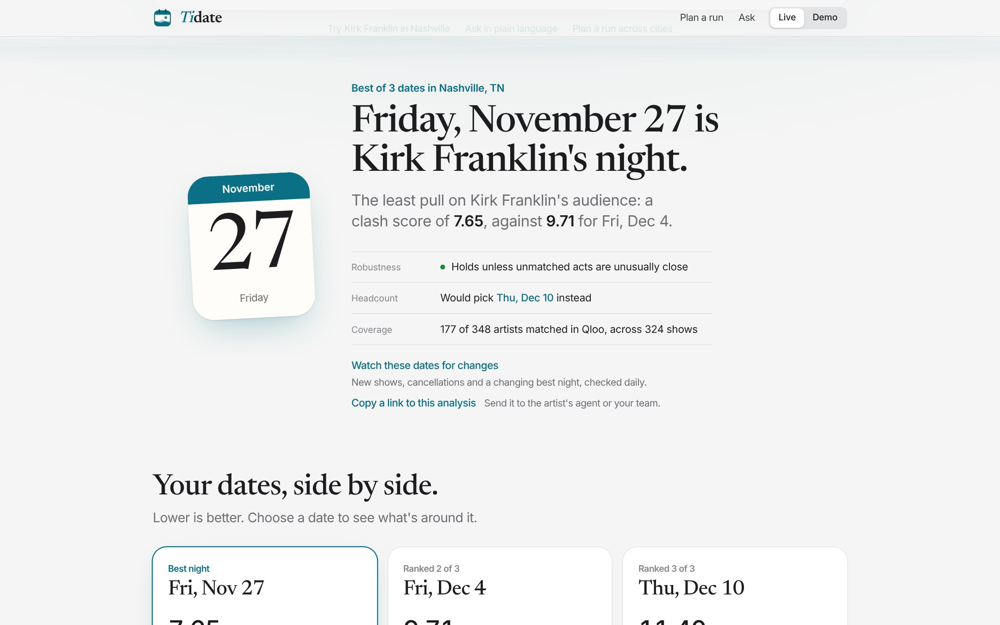
</p>

---

## Overview

A promoter holding three possible dates for a show usually checks the local
calendar and picks the quietest one. A headcount treats every show the same, but
a metal festival doesn't take fans from a gospel concert, while one same-genre
headliner across town can.

Tidate weighs every music event near each candidate date by how close its
audience is to your artist's, according to Qloo. It ranks the dates by that pull,
shows the plain headcount beside it so you can see when the two disagree, and
breaks every score down into the shows, signals and timing behind it.

**Who it is for:** concert promoters, talent buyers, agents and artist managers
choosing when to play a market.

**What it answers:**

- Which of the dates I can hold is least crowded for this artist's audience?
- Which nights in the next few weeks are quietest, and which should I avoid?
- Across several cities, which night in each makes the best run?
- Which acts could open, and which venues sit where the fans are?
- Has anything changed since I last looked?

Live data comes from the Ticketmaster Discovery API and the Qloo API. Without
keys, Tidate runs on a fictional demo scenario that is labelled as fictional
everywhere it appears.

## Features

### Compare the dates you can hold

Enter an artist, a city and up to four dates. Tidate searches Ticketmaster for
every music event within two weeks of each date, matches each performer to Qloo,
fetches each act's affinity with your artist, and scores the dates. The result
names the best night, says whether the ranking would survive the acts it could
not match, and shows what a plain headcount would have picked.

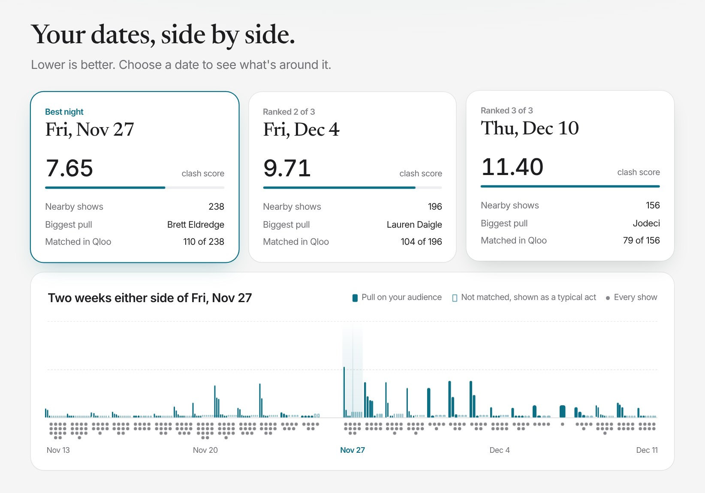

### See where Qloo changes the decision

The same shows ranked two ways: by headcount, and weighted by audience overlap.
When the lines cross, Qloo changed the answer, and a short note built from the
data explains why.

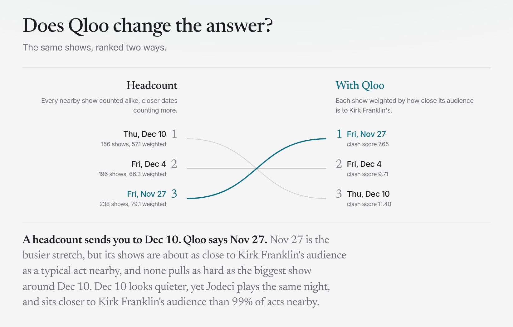

### Every number explained

Each show's contribution is its closeness to your audience, times its popularity,
times a timing weight, all shown and multiplied out. Shared Qloo genres and
influences explain *why* two audiences overlap, and say so plainly when they share
none. Untick a show you expect to move and the ranking updates in the browser.

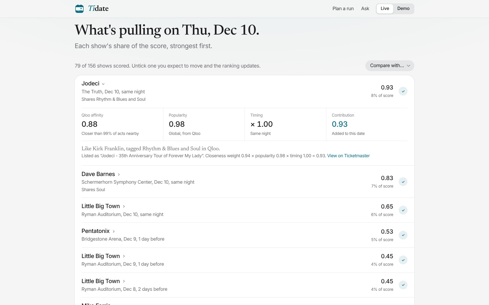

### Find a night

No dates yet? Give a range of up to 70 days and the nights of the week. Every
matching night is scored and shaded on a calendar: darker nights carry more pull,
the best three are numbered, and the headcount's pick is underlined. A night that
is quiet for every act, like a holiday, is flagged rather than recommended blindly,
and skipping it re-ranks instantly. While performers are still being matched, a
provisional ranking streams into the progress panel.

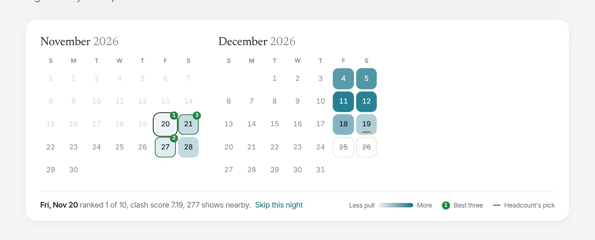

### Plan a run across cities

Pick up to four cities and a range. Tidate searches each city's nights, then
chooses one night per city so that no two shows are closer than the gap you set
and the run as a whole carries the least pull. It explains each trade-off ("its
best night is the night Atlanta gets") and shows the route a headcount would take.

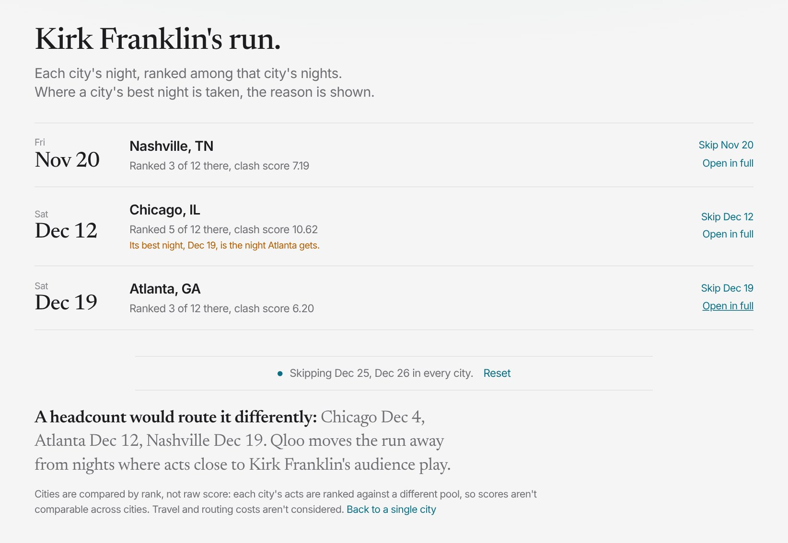

### Who could open, and where to play

Qloo's location-weighted recommendations suggest support acts whose fans overlap
the headliner's, leaving out anyone already competing nearby. Qloo's heatmap shows
where the artist's audience is concentrated, with the venues pulling hardest on the
chosen night pinned on top and venues ranked by fan concentration and nearby
competition.

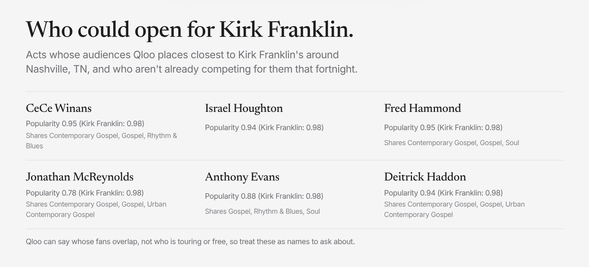

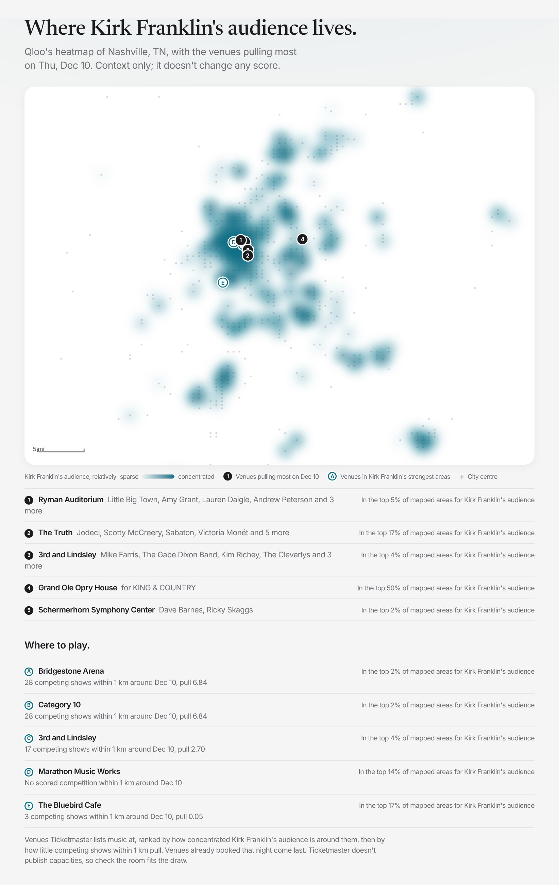

### Watch for changes

One click turns a result into a watch. It is re-checked every day, and on demand,
with the same engine. The watch page records what changed: new or cancelled shows
near your dates, a show that moved, a new best night, a change in robustness.
Notable changes get a two-sentence summary from the language model, which is
discarded if it contains any number that isn't in the change list.

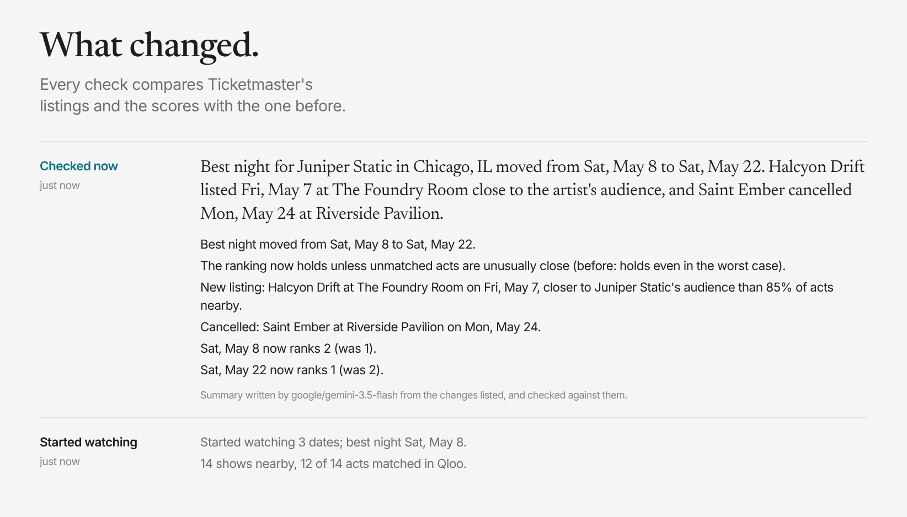

<sub>Shown with the fictional demo data, which announces one show and cancels another after the first check.</sub>

### Ask in plain language

An agent answers questions like "I can hold Nov 27, Dec 4 or Dec 10 for Kirk
Franklin in Nashville. Which is least crowded for his fans?" It calls the same
tools as the page, never produces a number itself, and its answer is checked
against the engine's recommendation before it is shown.

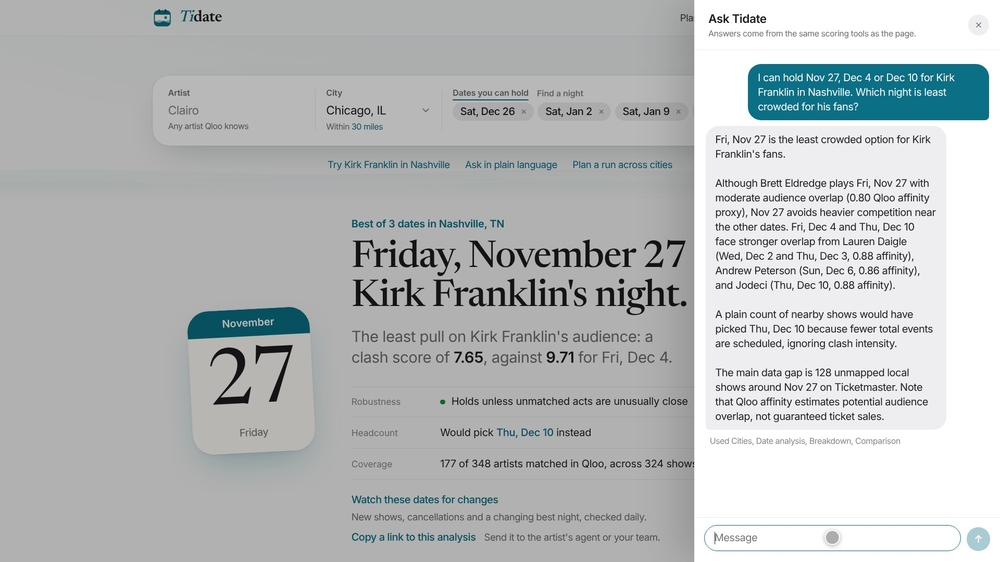

### Light, dark and phone

<p>
  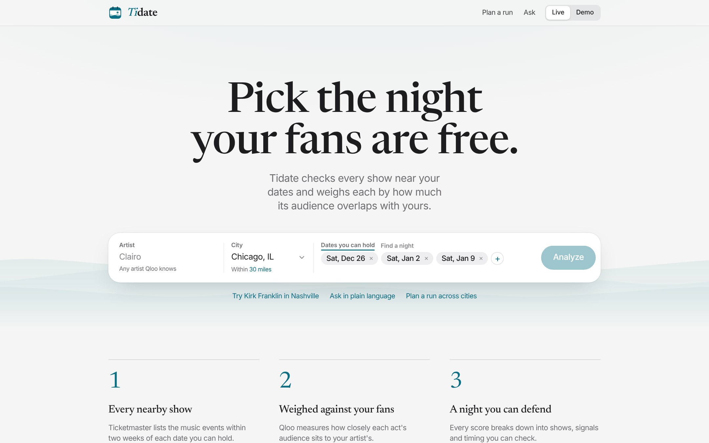
  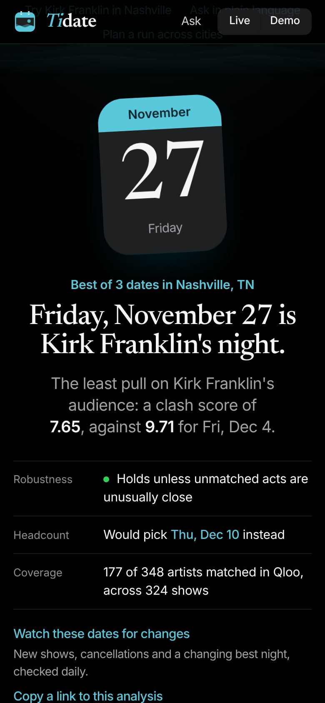
</p>

## How it works

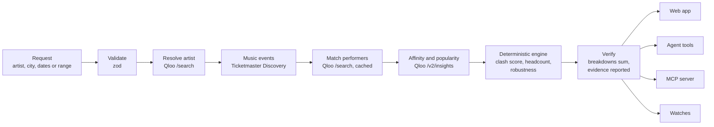

One pipeline serves the web app, the agent, the MCP server and watches, so every
surface gives the same answer for the same data.

1. **Validate.** One to four real dates, or a range with 2–40 matching nights; a
   supported market.
2. **Resolve the artist** in Qloo. Anything other than a confident match stops and
   asks which artist is meant.
3. **Fetch events** from Ticketmaster within the chosen radius, 14 days either side
   of the dates. Windows over Ticketmaster's 1,000-result paging limit are split
   and merged.
4. **Exclude**, with a recorded reason: the artist's own shows, cancelled and
   postponed events, TBA dates and duplicate listings.
5. **Match performers** to Qloo with a strict policy: exact names only; ambiguous,
   weak and missing matches stay unscored and are bounded instead. Lookups run in
   order of their weight on the dates, under a time limit, with a shared cache so
   later runs reach further.
6. **Fetch affinity** for every matched act, with the artist as Qloo's signal.
7. **Score** deterministically and **verify** that every breakdown sums to its total.

## The scoring model

```
C(d) = Σ  K_i × S_i × W(|d − d_i|)        over music events i within 14 days of date d
```

| Term | Meaning | Source |
| --- | --- | --- |
| `K_i` | Closeness: the act's Qloo affinity, ranked against every matched act nearby (mid-rank percentile), raised to the power 4 | Qloo `/v2/insights` `query.affinity` |
| `S_i` | Size: Qloo's global popularity percentile; 0.50 when missing, and flagged | Qloo `popularity` |
| `W` | Timing: same night 1.0, 1–2 days 0.7, 3–7 days 0.4, 8–14 days 0.15 | Fixed, stated hypothesis |

Lower is better: a lower clash score means less pull on your artist's audience.

- **Why a rank.** Qloo's artist-to-artist affinity is compressed (an unrelated metal
  band can score 0.74 where a near-identical artist scores 0.98), so raw values would
  mostly count shows. Ranking each act against the others nearby keeps Qloo's
  ordering and drops the compressed scale.
- **Headcount baseline.** The same shows and timing weights, every show counted
  alike, so the comparison isolates what Qloo adds.
- **Robustness.** Unmatched acts are checked twice: once as if each were a perfect
  match for your audience (worst case), once as if each were a typical act nearby.
  The verdict says which of those the ranking survives.
- **Evidence quality.** Each date reports how much of its nearby activity (time-
  weighted) could be scored; weak evidence is flagged as a lower bound.

The full method, including the matching policy and the alternatives considered, is
in [docs/METHODOLOGY.md](docs/METHODOLOGY.md).

### How Qloo is used

| Qloo capability | Used for |
| --- | --- |
| `/search` (artists) | Resolving the artist and every competing performer, with ambiguity detection |
| `/v2/insights`, artist signal, `filter.results.entities` | Affinity of each competing act with the artist: the core of the score |
| `/v2/insights`, artist signal, `signal.location.query` | Location-weighted recommendations for support acts |
| `/v2/insights`, `filter.type=urn:heatmap`, point and radius | Where the artist's audience is concentrated, for the fan map and venue ranking |
| `/entities` tags | Shared genres, lineage and influences that explain an overlap |

Only affinity and popularity feed the score. Tags, heatmaps and recommendations
are context, labelled as such, and never change a number. Every call was checked
against the live API first; the findings are in
[docs/API_VALIDATION.md](docs/API_VALIDATION.md).

## Evaluation

Ticketmaster has no historical archive, so outcomes such as ticket sales can't be
backtested. The experiments test what the data can support and were written down
before the data was collected ([docs/EVALUATION.md](docs/EVALUATION.md)).
Live data, October 2026: 6 US markets, 146 artists, 37,913 artist–competitor pairs.

| Question | Result |
| --- | --- |
| Does Qloo affinity track audience overlap? (same-genre competitors, by Ticketmaster's independent genre labels, should rank above different-genre ones) | **AUC 0.618** (95% CI 0.590–0.647) vs **0.556** for popularity alone; affinity beats popularity in all 6 markets |
| Does Qloo change the decision? | It recommends a different date from the headcount in **27%** of 150 real scenarios, and orders the dates differently in 56% |
| Are high-clash dates more likely to be cancelled? | Insufficient data: 11 matched cases against a pre-set minimum of 30; no claim made |

The effect is modest and genre is a coarse proxy for shared audiences, so this
supports, but does not prove, that affinity reflects audience overlap. It cannot
show that changed decisions are better, because no sales or attendance data exists.

## Agent and MCP server

### Agent

A Vercel AI SDK `ToolLoopAgent` with these tools, all backed by the same pipeline:

| Tool | Does |
| --- | --- |
| `list_markets` | Supported cities |
| `find_artist` | Resolves an artist in Qloo, reporting exact, ambiguous, weak or not found |
| `analyze_candidate_dates` | Scores 1–4 dates |
| `find_best_nights` | Scores every matching night in a range |
| `explain_date` | Full breakdown for one date, including unscored shows |
| `compare_dates` | Which shows account for the difference between two dates |
| `what_if_exclude` | Re-scores without shows the user expects to move |
| `watch_latest` | Starts a watch on the latest analysis |

The agent is instructed to use tools for every fact. Its final answer is checked
deterministically: if it doesn't name the engine's recommended date, the engine's
verdict is appended. Several API keys and models can be configured; on rate
limits, overload or refused keys it moves to the next one.

### MCP server

`/api/mcp` serves the Model Context Protocol over Streamable HTTP. The public instance:

```json
{ "mcpServers": { "tidate": { "url": "https://tidate.vercel.app/api/mcp" } } }
```

For clients that only speak stdio: `npx mcp-remote https://tidate.vercel.app/api/mcp`.

| Tool | Input |
| --- | --- |
| `score_candidate_dates` | `{ artist, marketId, candidateDates[], artistEntityId?, mode? }` |
| `find_best_nights` | `{ artist, marketId, from, to, nights?, artistEntityId?, mode? }`, `nights` one of `fri-sat` (default), `thu-sat`, `all` |
| `find_artist` | `{ name, mode? }` |
| `list_markets` | none |

Results include structured evidence and a text summary, and are labelled as demo
data when the server has no live keys.

## Architecture

| Layer | Technology |
| --- | --- |
| App | Next.js 16 (App Router, route handlers), React 19, TypeScript |
| Validation | zod 4 on every request and every upstream response |
| Agent | Vercel AI SDK 7 `ToolLoopAgent`; Gemini by default, OpenAI or Anthropic optional |
| MCP | `mcp-handler` with `@modelcontextprotocol/server` |
| Storage | Upstash Redis over REST for watches and the shared match cache; in-memory fallback for local use |
| Scheduling | A daily cron route for watch checks and cache warming |
| Tests | Vitest: 92 tests, no network |

```
src/lib/scoring/engine.ts   deterministic scoring, headcount baseline, robustness, counterfactuals
src/lib/pipeline.ts         shared orchestration: compare, night search, provisional ranking
src/lib/qloo/               Qloo client, matching policy, shared-taste comparison
src/lib/ticketmaster/       Ticketmaster Discovery client with window splitting
src/lib/agent/              agent tools, ToolLoopAgent, answer verification
src/lib/mcp/server.ts       MCP tool definitions
src/lib/watch/              watches: store, snapshots and diffs, alerts, cache warming
src/lib/tour.ts             one-night-per-city run planner (branch and bound)
src/lib/context.ts          fan map, venue ranking, support-act ideas (display only)
src/lib/demo/provider.ts    fictional demo scenario
src/app/api/                analyze (NDJSON stream), agent, artists, mcp, status, taste,
                            fanmap, openers, watch
src/app/tour, src/app/watch run planner and watch pages
src/components/             UI
scripts/                    live API validation, evaluation, cache warming
tests/                      unit, pipeline, agent, MCP and watch tests
docs/                       methodology, evaluation, API validation, prior art
```

### HTTP API

| Route | Purpose |
| --- | --- |
| `POST /api/analyze` | Runs an analysis (`kind: "compare"` or `"discover"`) and streams progress as NDJSON |
| `POST /api/agent` | One turn of the conversational agent |
| `GET /api/artists` | Artist lookup with match status |
| `GET /api/taste`, `/api/fanmap`, `/api/openers` | Shared tags, heatmap and support-act ideas (context only) |
| `POST /api/watch`, `GET/DELETE /api/watch/:id`, `POST /api/watch/:id/check` | Watches |
| `GET /api/watch/cron` | Daily watch checks and cache warming (requires `CRON_SECRET`) |
| `GET /api/status` | Which integrations are configured, never their values |
| `/api/mcp` | MCP server |

## Getting started

Requirements: Node.js 20 or later.

```bash
git clone https://github.com/Abdullah49645/tidate.git
cd tidate
npm install
cp .env.example .env.local   # add keys, or leave empty for demo mode
npm run dev                  # http://localhost:3000
```

### Configuration

| Variable | Needed for | Notes |
| --- | --- | --- |
| `QLOO_API_KEY` | Live data | Qloo API key; defaults to `https://hackathon.api.qloo.com` (override with `QLOO_BASE_URL`) |
| `TICKETMASTER_API_KEY` | Live data | Consumer key from developer.ticketmaster.com |
| `GOOGLE_GENERATIVE_AI_API_KEYS` | Agent | Comma-separated Gemini keys, tried in order. `OPENAI_API_KEY` or `ANTHROPIC_API_KEY` also work |
| `KV_REST_API_URL`, `KV_REST_API_TOKEN` | Persistent watches, shared cache | Upstash Redis REST credentials (`UPSTASH_REDIS_REST_URL` / `_TOKEN` also accepted) |
| `CRON_SECRET` | Daily checks | Random string of 16+ characters, sent by the scheduler as a bearer token |
| `TIDATE_LOOKUP_BUDGET_MS` | Optional | Performer lookup time limit for an analysis (default 30000) |
| `TIDATE_DISCOVER_BUDGET_MS` | Optional | Lookup time limit for a night search (default 45000) |
| `TIDATE_LLM_PROVIDER`, `TIDATE_LLM_MODEL` | Optional | Choose the agent's provider and model order |
| `TIDATE_FORCE_DEMO=1` | Optional | Use demo data even when keys are present |

Without data keys the app runs in **demo mode**. Live mode is never silently
replaced with demo data, and without a store, watches live in memory.

### Scripts

```bash
npm run dev            # development server
npm test               # 92 tests; no network
npm run typecheck
npm run lint
npm run build
npm run check          # typecheck, lint, tests and build
npm run validate:live  # exercises the real Qloo and Ticketmaster operations
npm run eval:collect   # collects evaluation data (live keys)
npm run eval:run       # runs the pre-registered experiments
npm run warm:cache     # pre-fills the shared match cache for every market (or name some)
```

`validate:live` and `eval:collect` keep raw API responses in gitignored folders;
Qloo data is never committed.

## Data, privacy and provenance

- Every result records where each value came from: Ticketmaster event ids and
  retrieval time, the Qloo requests made (never keys), each performer's matching
  status and the scoring version.
- Ticketmaster event data is cached for 15 minutes. Qloo artist searches are cached
  privately for up to 30 days to speed up later runs.
- A watch keeps a compact record of the events near its dates so the next check can
  tell what changed. It is deleted when you stop watching and expires 120 days
  after its last check. The watch link is its only credential.
- No accounts and no personal data. Demo results are marked as fictional in the
  data, the UI, agent answers and MCP output.

See [NOTICE.md](NOTICE.md) for third-party data terms.

## Limitations

- Qloo affinity is a proxy for potential audience overlap, not shared ticket
  buyers or purchase intent. Popularity is global, not local.
- Ticketmaster doesn't list every show, and doesn't publish venue capacity.
- Performers without a confident Qloo match aren't scored; their possible effect is
  bounded and reported instead. Lookups are time-limited, so a first run in a busy
  market may leave distant acts unchecked; later runs reach further.
- Timing weights are a stated hypothesis, not fitted to outcomes.
- A lower clash score is not a sales forecast.

## Documentation

- [Methodology](docs/METHODOLOGY.md): pipeline, score, matching policy,
  robustness, night search, run planning, watches
- [Evaluation](docs/EVALUATION.md): pre-registered experiments and results
- [API validation](docs/API_VALIDATION.md): what the live Qloo and Ticketmaster APIs
  actually return
- [Prior art](docs/PRIOR_ART.md): existing tools and how Tidate differs

## License

[MIT](LICENSE) © Abdullah Bin Saad. Event data from Ticketmaster; taste,
affinity and heatmap data from Qloo; both are governed by their providers' terms
(see [NOTICE.md](NOTICE.md)).
